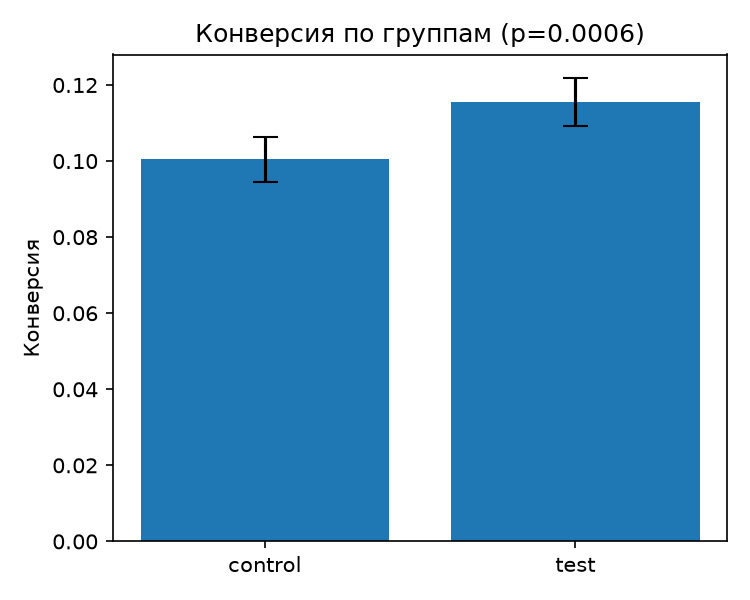

# A/B Test Analysis in Python

Analysis of an A/B test on synthetic data: sample ratio check, significance test for conversion and bootstrap for revenue.

> **Note:** the data is synthetic and produced by `generate_data.py`. The effect (+1.5 percentage points of conversion) is planted on purpose, so the results demonstrate the methods, not a real product change.

## About

The project walks through the standard steps of analyzing an experiment:

1. verify that traffic was split as planned (SRM check);
2. compare conversion between groups and quantify the uncertainty;
3. compare revenue per user, which is skewed and full of zeros;
4. look at the effect across platforms.

## Data

`generate_data.py` creates `ab_data.csv` with 20,000 users.

| Column | Description |
|---|---|
| `user_id` | user identifier |
| `group` | `control` or `test`, assigned randomly 50/50 |
| `platform` | `ios`, `android` or `web` |
| `converted` | whether the user converted (`True` / `False`) |
| `revenue` | revenue of the user, `0` if not converted |

Base conversion is 10%, the test group has 11.5% (planted effect). Revenue of converted users follows a lognormal distribution.

## Methodology

**1. SRM check.** A Pearson chi-square goodness-of-fit test checks that the split is 50/50 (threshold α = 0.001). A tiny p-value would mean the split is broken and results cannot be trusted. SRM shows that a mismatch exists, not what caused it.

**2. Conversion.** Two-proportion z-test. The p-value uses a pooled standard error (under H₀ both groups share one conversion rate); the 95% confidence interval of the difference uses unpooled standard errors.

**3. Revenue per user (ARPU).** Revenue is right-skewed with many zeros, so the normality assumption of a t-test is questionable. A percentile bootstrap (2,000 resamples) gives a 95% confidence interval for the difference in ARPU.

**4. Platform breakdown.** Conversion by platform as a sanity check. Differences between platforms are not tested for significance.

## Results

Synthetic data, 20,000 users.

| Metric | Control | Test | Difference | 95% CI | p-value |
|---|---|---|---|---|---|
| Users | 10,072 | 9,928 | — | — | SRM: 0.31 (OK) |
| Conversion | 10.05% | 11.56% | +1.52 p.p. (≈ +15% relative) | [+0.66; +2.38] p.p. | 0.0006 |
| ARPU | 20.35 | 24.31 | +3.96 | [+1.25; +6.56] (bootstrap) | — |



## Project structure

```
.
├── generate_data.py   # synthetic data generator
├── analyze.py         # SRM, z-test, bootstrap, platform breakdown, plot
├── requirements.txt   # dependencies
├── conversion.png     # output plot
└── README.md
```

## Getting started

### Prerequisites

- Python 3.9+

### Installation

```bash
git clone https://github.com/whynotyuno/<repository-name>.git
cd <repository-name>
pip install -r requirements.txt
```

### Usage

```bash
python generate_data.py   # creates ab_data.csv
python analyze.py         # prints results, saves conversion.png
```

## Limitations

- Synthetic data with a hand-set effect.
- No power analysis or sample size calculation.
- Platform segments are not corrected for multiple comparisons.
- A single primary metric; guardrail metrics are not modeled.

## Author

[whynotyuno](https://github.com/whynotyuno)
